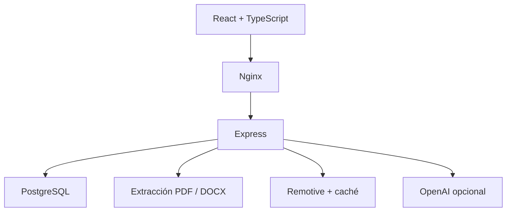

# AI Job Hunter

**Cambio de contraseña y recuperación local:** consulta [la guía de contraseñas](docs/CONTRASENAS.md) para instalar esta actualización y recuperar el acceso desde la terminal. No requiere cambios de `.env` ni una nueva migración de base de datos.

## Actualización: cuentas y sesiones

La instalación local ahora requiere iniciar sesión. El registro está cerrado por defecto y se puede habilitar con `ALLOW_REGISTRATION=true`. Los datos anteriores se reservan para una cuenta propietaria que se activa desde la terminal. **Lee [la guía de cuentas y actualización](docs/CUENTAS-Y-SESIONES.md) antes de reconstruir los contenedores.** La demo pública continúa sin cuentas reales.


**Un espacio para organizar la búsqueda de empleo: del CV a la postulación.**

Aplicación full stack local que reúne un perfil profesional reutilizable, importación de CV en PDF/DOCX, búsqueda de vacantes remotas y seguimiento de oportunidades. Incluye un modo demo sin consumo de IA y una integración opcional con OpenAI para comparar un CV con una vacante.

## Interfaz y arquitectura renovadas

React + TypeScript + **Tailwind CSS 4 y shadcn/ui**, con navegación lateral, panel de indicadores, formularios por sección y seguimiento paginado. El mismo frontend genera la aplicación local y la demo pública.

**[Abrir demo de portafolio](https://ai-job-hunter-demo.lilaclamp64.chatgpt.site)** · Datos ficticios, sin IA y almacenamiento en el navegador. Un push a GitHub no publica automáticamente esa demo.

- [Arquitectura explicada y límites de escalabilidad](docs/ARQUITECTURA.md)
- [Actualizar una instalación existente sin perder datos](docs/ACTUALIZAR-V2.md)
- [Validación de esta versión](docs/VALIDATION.md)

Las capturas de `docs/screenshots` documentan la interfaz anterior; el script de capturas se adaptó a la nueva navegación.

## Qué resuelve

Evita repetir el mismo CV y dispersar las oportunidades entre pestañas y notas. Puedes guardar un perfil, importar un documento, revisar ofertas en su fuente original y registrar el avance de tus postulaciones.

| Función | Estado |
| --- | --- |
| Perfil profesional editable en PostgreSQL | Implementada |
| PDF/DOCX → vista previa de texto editable | Implementada, sin OCR |
| Vacantes remotas de Remotive y filtros | Implementada, requiere internet |
| Guardado sin duplicados y estados | Implementada |
| Comparación con IA y borradores | Integrada; requiere clave y saldo de OpenAI |
| Modo demo | Disponible sin clave; resultado simulado identificado |
| Envío automático de postulaciones | No incluido |
| Autenticación y despliegue multiusuario | Pendientes |

## Stack y arquitectura

| Capa | Tecnología |
| --- | --- |
| Interfaz | React + TypeScript + Vite + Tailwind CSS 4 + shadcn/ui |
| API | Node.js 24 + Express, JavaScript ESM |
| Datos | PostgreSQL 17 |
| Documentos | pdf-parse, Mammoth, Multer y workers de Node |
| Infraestructura | Nginx + Docker Compose |
| Calidad | ESLint, Node test runner y GitHub Actions |



Las claves se leen en el backend. Los documentos se procesan en memoria y su texto se revisa antes de usarlo. Las ofertas se normalizan a texto y se enlazan a su fuente original.

## Arranque local

Necesitas Docker Engine y Docker Compose. Para una **instalación nueva**:

```bash
cp .env.example .env
docker compose up -d --build
```

Abre **http://localhost:8080**. La configuración inicial usa `AI_MODE=demo`, sin clave ni llamadas a OpenAI.

Si ya usabas el proyecto, **conserva tu `.env`, contraseña de PostgreSQL y carpeta original**. Copia los archivos nuevos sobre ella y ejecuta:

```bash
docker compose up -d --build
docker compose restart web
```

`docker compose down` conserva la base. No uses `down -v` si quieres mantener perfiles y oportunidades.

## Recorrido rápido

1. Completa «Mi perfil» y guárdalo.
2. Importa tu CV o prueba con `backend/test/fixtures/cv.docx` (datos ficticios).
3. Revisa el texto extraído antes de copiarlo al campo CV.
4. Busca una tecnología; deja ubicación vacía para ampliar resultados.
5. Guarda una oferta o pulsa «Preparar análisis».
6. Prueba el modo demo y registra el estado de tu postulación.

Guardar una vacante o marcarla como postulada no envía ninguna solicitud. Las vacantes guardadas y el historial de análisis tienen estados independientes.

## Seguimiento de postulaciones

En **Mis oportunidades**, pulsa **Editar seguimiento** para guardar el enlace de la oferta, fecha de postulación, próximo seguimiento y notas (hasta 5.000 caracteres). El enlace de una vacante seleccionada se conserva al crear el análisis; también puedes introducirlo manualmente.

El filtro **Seguimiento pendiente** muestra fechas de hoy y vencidas, excluyendo Oferta y Descartada. Usa el día local del navegador, sin convertirlo a UTC. Consulta los registros antes de paginar y muestra 20 por página, empezando por los pendientes más antiguos. Pulsa **Actualizar lista** para refrescar la fecha si mantienes la página abierta de un día a otro.

Cuando completes un seguimiento, cambia la fecha o déjala vacía. El estado y las fechas son independientes: marcar Postulada no inventa una fecha de envío. No se envían recordatorios ni postulaciones automáticamente. Estos campos pertenecen al historial de análisis; la sección Vacantes guardadas mantiene su seguimiento independiente.

Para actualizar una instalación existente, conserva la carpeta y el `.env`, y ejecuta `docker compose up -d --build` seguido de `docker compose restart web`. La API añade una columna JSONB de forma repetible sin borrar registros. No uses `docker compose down -v`.

## Activar la IA opcional

En `.env`, configura `AI_MODE=openai`, `OPENAI_API_KEY` y `OPENAI_MODEL` con un modelo habilitado en tu cuenta que admita Responses API y Structured Outputs. Después recrea la API y reinicia el proxy:

```bash
docker compose up -d --force-recreate api
docker compose restart web
```

Al ejecutar un análisis real se envían el CV y la vacante a OpenAI y se consume saldo de API. Revisa los textos generados; la puntuación orientativa no es una probabilidad de contratación. El modo demo no produce una puntuación ni finge evaluar tu perfil.

## Pruebas y CI

Para trabajar fuera de Docker, usa Node.js 24:

```bash
npm ci
npm run lint
npm test
npm run build
```

El workflow `.github/workflows/ci.yml` ejecuta en orden:

1. Lint.
2. Pruebas de lógica, parsers y contratos HTTP.
3. Compilación de frontend e imágenes Docker de API y web.
4. Arranque con Compose y smoke test a través de Nginx, con PostgreSQL real en el runner.

El smoke test comprueba salud, perfil persistente, importación DOCX, análisis demo y seguimiento. No llama a OpenAI ni a Remotive. Usa una base vacía y desechable: no lo ejecutes sobre tus datos personales. La contraseña de CI se genera para cada ejecución y no requiere secretos de GitHub.

**Validación local de esta entrega:** consulta [docs/VALIDATION.md](docs/VALIDATION.md). La ejecución completa del workflow debe confirmarse en GitHub; no se presenta como exitosa antes de ejecutarse.

## Capturas reproducibles

```bash
npx playwright install chromium
npm run screenshots
```

El script abre la compilación real en un servidor temporal, intercepta las llamadas a API con datos ficticios y produce las capturas. No consulta tu base, claves, CV ni fuentes externas.

## Límites actuales

- Aplicación local expuesta en `127.0.0.1`, con cuentas, sesiones y datos separados por usuario. Registro cerrado por defecto. Antes de publicarla como servicio requiere HTTPS, recuperación y verificación por correo, gestión de abuso y pruebas de carga; consulta la guía de cuentas.
- PDF/DOCX hasta 5 MiB; PDF hasta 30 páginas. Los documentos escaneados necesitan OCR, todavía no incluido.
- CV y vacante hasta 16.000 caracteres. El orden de columnas o tablas puede requerir correcciones manuales.
- Remotive ofrece un catálogo parcial con retraso de publicación; la aplicación conserva una copia hasta seis horas entre consultas. Verifica vigencia y ubicación en la oferta original.
- Los tests de rutas locales utilizan almacenamiento simulado; el smoke test de CI está destinado a comprobar la integración real con PostgreSQL.

## Estructura

```text
backend/src/modules/   Módulos de análisis, perfil, documentos y vacantes
backend/src/db/        Migraciones versionadas
backend/test/          Pruebas y documentos sintéticos
frontend/src/app/      Navegación, panel y composición
frontend/src/features/ Funciones de la aplicación
frontend/src/lib/      Adaptador de datos y utilidades
frontend/src/data/demo/ Adaptador y datos de demostración
frontend/src/components/ui/ Componentes shadcn/ui
scripts/               Smoke test y capturas reproducibles
docs/                  Capturas, validación y guía de presentación
.github/workflows/     Integración continua
compose.yaml           Servicios locales
```

## Fuentes y documentación

Las ofertas provienen de [Remotive](https://remotive.com), con atribución y enlace al anuncio original. Consulta sus [condiciones de API](https://github.com/remotive-com/remote-jobs-api) antes de redistribuir el catálogo. No se publican ofertas en otros portales ni se exige registro para verlas.

- [Guía para presentar el proyecto y subirlo a GitHub](docs/PORTFOLIO.md)
- [Historial de actualización y detalles de las funciones](docs/UPGRADE.md)
- [Structured Outputs de OpenAI](https://developers.openai.com/api/docs/guides/structured-outputs)

Proyecto desarrollado con asistencia de IA. Para presentarlo en entrevistas, explica las decisiones técnicas, valida el comportamiento y distingue las funciones reales de la demostración.
